# Analyse : Leano (@leano.tips), « Claude t'a offert un bouton caché, « Reset for free », et il va expirer »

### 1. Informations

| Champ | Valeur |
|---|---|
| Plateforme | TikTok (1080×1920, 9:16) |
| Auteur | Leano, @leano.tips |
| URL | https://www.tiktok.com/@leano.tips/video/7694698758184963360 |
| Date | 9 octobre 2026 |
| Durée | 39 s, environ 128 mots en 38 s (≈ 200 mots/min, débit très rapide) |
| Vues | 7 994 |
| Likes | 245 (3,06 % des vues) |
| Commentaires | 4 (0,05 %) |
| Partages | 55 (0,69 %) |
| Enregistrements | 211 (2,64 % des vues, soit 86 % du nombre de likes) |
| Son | « son original - Leano » (voix off, pas de musique tendance) |
| Langue | Français |
| Légende d'origine | « Claude t'a offert un bouton caché, « Reset for free », et il va expirer. Avec Claude Opus 5.5, il remet ta limite à zéro en un clic. ENREGISTRE ça. Et toi, tu le claques maintenant ou tu le gardes ? 👇 #ia #claude #anthropic #astucesia » |

Profil d'engagement : très fort sur l'enregistrement, correct sur le like, quasi nul sur le commentaire. C'est un contenu « fiche pratique » qu'on garde, pas un contenu qui fait débattre.

### 2. Titre et Description

- **Titre optimisé :** Ton reset gratuit sur Claude expire : 4 façons de le perdre
- **Description :** Si tu payes Claude, tu as un reset de limite gratuit caché dans Réglages > Utilisation. Mais il ne marche que sur le web, il est irréversible et il a une date d'expiration. Enregistre avant de le perdre 👇 Tu le claques maintenant ou tu le gardes pour le jour où tu bloques ? #claude #claudeai #anthropic #ia #astuceia #productivite

### 3. Script de la Voix Off

Moteur : Whisper `base`, corrigé avec le texte affiché à l'écran.

**Hook (00:00–00:03)**
Claude t'a offert un bouton caché. Il va expirer.

**Corps**

*Qualification (00:03–00:06)*
Si tu payes Claude, regarde ça avant de le perdre.

*Le cadeau (00:06–00:11)*
Avec Claude Opus 5.5, Anthropic a offert aux abonnés un reset de limite, à déclencher quand tu veux. [reconstitué : Whisper entend « Claude plus 5.5, entrepique », corrigé d'après les cartes « // Claude Opus 5.5 » et « Source : Anthropic, 2026 »]

*Le bouton (00:11–00:19)*
Il est là : Réglages, Utilisation, section Resets, bouton « Reset for free ». Un clic, ta limite de 5 heures ou ta limite hebdo repart à zéro. [reconstitué : « t'as limite… repare » corrigé d'après l'écran « ou ta limite » et la carte « Cinq heures / Hebdo »]

*Les pièges (00:19–00:33)*
Sauf qu'il y a quatre façons de le perdre.
Un : pas de bouton sur mobile ni dans Claude Code, passe par le web.
Deux : c'est irréversible.
Trois : tu downgrades ou tu résilies, il disparaît. [reconstitué : Whisper « tu dain de grade », écran « Downgrade ou résiliation »]
Quatre : il expire. La date est dans tes réglages.

**Outro/CTA (00:33–00:39)**
C'est un joker, garde-le pour le jour où tu bloques.
Enregistre ça. Et toi, tu le claques maintenant ou tu le gardes ?

### 4. Ingénierie Inverse : Pourquoi ça marche ?

- **Le Hook (L'accroche) :** trois déclencheurs en 2,8 s. « T'a offert » : le spectateur possède déjà quelque chose (effet de dotation). « Bouton caché » : une information d'initié (écart de curiosité). « Il va expirer » : la perte arrive (aversion à la perte et urgence). À l'écran, le texte s'écrit mot par mot en même temps que la voix : on lit ce qu'on entend, donc la vidéo fonctionne aussi sans le son. Le mot-clé est en serif italique rouge (« caché », « free », « expirer »), un sticker « IL VA EXPIRER » est posé de travers et un sablier au sable rouge rend la perte visible. L'avatar, bras croisés, regarde de côté avec un sourire en coin : il a l'air de savoir quelque chose. À 2,8 s, « Si tu payes Claude » filtre l'audience : l'abonné se reconnaît et reste, les autres partent tôt sans plomber la rétention moyenne. Le fond crème très sobre tranche aussi avec un fil TikTok fait de visages filmés.
- **Structure et Rythme :** une structure de fiche technique en chapitres titrés en monospace (`// 01 — le bouton`, `// 02 — le cadeau`, `// 03 — les pièges`, `// 04 — verdict`). La progression va de la promesse à la preuve (source Anthropic affichée), au mode d'emploi (chemin en 4 clics puis maquette de l'interface avec curseur), au retournement, à la liste numérotée, au verdict et enfin à la question. L'outil de rétention principal est le compteur **PIÈGES 0/4**, affiché en haut à droite dès la première image, avant même que les pièges soient annoncés. C'est une boucle ouverte visible en permanence (effet Zeigarnik) : le spectateur sait qu'il y a 4 choses à venir et que la vidéo n'est pas finie tant qu'on n'est pas à 4/4. Le retournement « Sauf qu'il y a quatre façons de le perdre » tombe à 19,5 s, exactement au milieu, avec une rupture visuelle : le fond passe au noir, des halos magenta et vert apparaissent, « quatre » est en jaune-lime et un gros « 4 » s'affiche. C'est un pattern interrupt placé là où la rétention décroche d'habitude. Les pièges se branchent ensuite un par un dans une barre comme des prises, ce qui donne une satisfaction de complétion façon jeu. Quelque chose change toutes les 1,5 à 3 s (mot, carte, interrupteur qui bascule, curseur qui clique) et l'avatar change d'expression à chaque phrase (scepticisme, alarme, sourire, larmes) : il remplace une face-cam sans tournage. Défauts visibles : les numéros de chapitre sont incohérents (01, puis 02, puis de nouveau 01, puis 03) et le compteur est décalé par rapport à la voix (il affiche 3/4 pendant « Deux : c'est irréversible »). Il y a aussi un plan vide de près d'une seconde à 00:33 (« 04 — verdict » sur fond nu), un temps mort juste avant le CTA.
- **Levier Psychologique :** le principal est l'**aversion à la perte**. Toute la vidéo parle de protéger un avantage déjà acquis, pas d'en gagner un : « avant de le perdre », « il va expirer », « 4 façons de le perdre », « il disparaît ». Viennent ensuite la **rareté et l'urgence** (une date d'expiration), l'**information d'initié** (« caché ») et l'**autorité** : « Source : Anthropic, 2026 » puis « Source : Centre d'aide Claude (Anthropic) » restent sous les yeux sur presque tous les plans, avec des maquettes d'interface réalistes (onglets de navigateur, « Réglages > Utilisation », jauges 58 % / 78 %). La cible est un abonné payant, chez qui joue aussi le coût irrécupérable : « je paye, je ne vais pas laisser filer ce qui m'est dû ». Enfin, l'**utilité immédiate** (le chemin exact en 4 clics) fait de la vidéo une référence à garder, d'où 2,64 % d'enregistrements.
- **Appel à l'action (CTA) :** il y en a deux. Le premier, « Enregistre ça », est dit à voix haute et affiché en rose avec un effet glitch. Il fonctionne : 211 enregistrements. Le second est une question binaire, « tu le claques maintenant ou tu le gardes ? », avec une fausse zone de commentaire « Et toi ? ». Il échoue : 4 commentaires (0,05 %). Il y a trois raisons. La vidéo affiche déjà deux faux commentaires qui couvrent les deux réponses possibles (« Je le claque maintenant » / « Je le garde pour le jour où je bloque ») : le spectateur voit sa réponse déjà écrite. Le verdict qui précède (« garde-le pour le jour où tu bloques ») tranche la question, donc il n'y a plus de tension. Et la question n'arrive qu'à 35,8 s, après le plan vide. Ce qui reste sur la table :
  - pas de CTA partage alors que le sujet s'y prête (« envoie ça à ton pote qui paye Claude ») ; les partages ne sont qu'à 0,69 % ;
  - pas d'abonnement ni de série (« je poste chaque bonus caché de Claude, abonne-toi pour le prochain ») ;
  - pas de mot-clé en commentaire (« écris RESET, je t'envoie le lien direct ») qui ferait monter les commentaires ;
  - une question ouverte, ou clivante, aurait mieux marché que la question binaire déjà résolue (« t'as déjà bloqué ta limite à quelle heure ? »).

### 5. Idées clés

Selon la vidéo, avec Claude Opus 5.5, Anthropic offre à ses abonnés payants un reset unique de limite d'utilisation, déclenché à la main. Il remet à zéro la limite de 5 heures ou la limite hebdomadaire. Le bouton se trouve dans Réglages > Utilisation > section Resets > « Reset for free », et uniquement sur le web. La vidéo conseille de le garder comme joker pour le jour où l'on est bloqué, car il est définitif et peut se perdre. Les affirmations sont présentées comme sourcées (Anthropic, Centre d'aide Claude) mais ne sont pas vérifiées ici.

- Le reset est offert aux abonnés et se déclenche quand on veut.
- Chemin : Réglages → Utilisation → Resets → Reset for free.
- Piège 1 : absent sur mobile et dans Claude Code, il faut passer par le web.
- Piège 2 : irréversible, aucune annulation.
- Piège 3 : un downgrade ou une résiliation le fait disparaître.
- Piège 4 : il expire, la date est dans les réglages.

Citations marquantes :
- [00:00] « Claude t'a offert un bouton caché. Il va expirer. »
- [00:19] « Sauf qu'il y a quatre façons de le perdre. »
- [00:33] « C'est un joker, garde-le pour le jour où tu bloques. »

### 6. Éléments visuels et prompts

Le format est entièrement en motion design 2D. Il n'y a pas de tournage : le personnage est un avatar illustré qui revient sur tous les plans, en bas à droite.

**Avatar (commun à toutes les scènes) :** jeune homme en dessin animé, 25 à 30 ans apparents, visage ovale, peau claire beige, cheveux châtain-brun courts en épis avec une mèche rebelle sur le dessus, sourcils bruns épais, grands yeux ronds blancs. Il porte un sweat à capuche anthracite aux cordons blancs, un t-shirt blanc visible au col et un casque audio gris autour du cou, avec un pin rond rouge cerclé de pointillés blancs sur la poitrine. Le trait est noir épais, en aplats avec un léger ombrage cel. Une ombre portée en trame de points noire (Ben-Day) est décalée derrière lui. Il est cadré au buste, en bas à droite, sur environ 45 % de la largeur. Accessoires d'expression : traits jaunes de surprise, gouttes de sueur, larmes, étincelle rouge, point d'interrogation orange.

#### Scène 1 (00:00–00:03) : Le hook, « bouton caché, il va expirer »
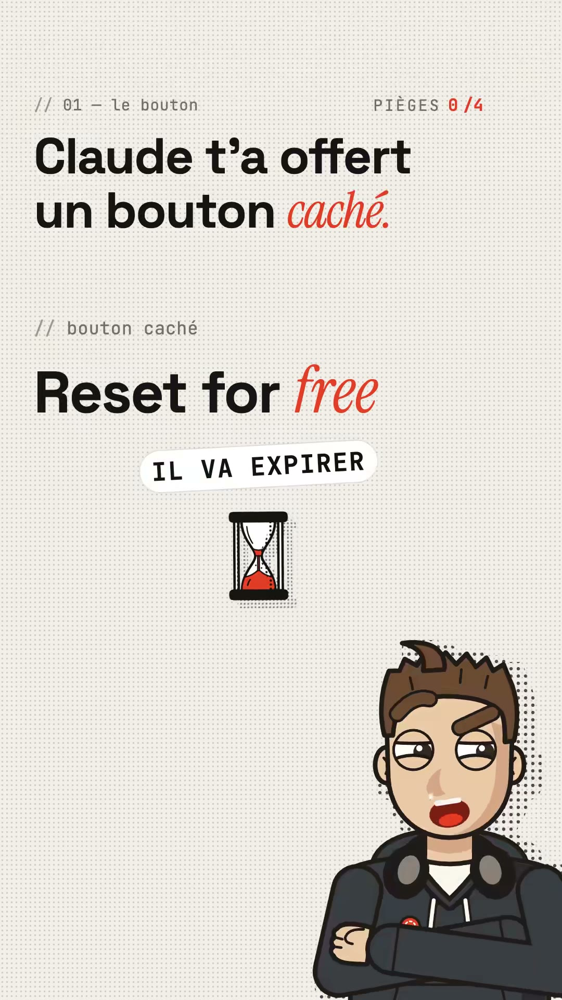

**Personnes :** l'avatar a les bras croisés et regarde de côté avec un sourire en coin (0,5 s), puis parle, bouche ouverte en rouge (1,5 à 2,5 s). Il a l'air sceptique et complice.
**Décor :** fond papier crème (#F1EEE8 environ) avec une fine grille de points gris. En haut à gauche, un label mono gris « // 01 — le bouton » ; en haut à droite, un compteur « PIÈGES 0/4 » aux chiffres rouges. Le titre en grotesk noir gras (type Space Grotesk) dit « Claude t'a offert un bouton *caché.* », le mot accent étant en serif italique rouge (type Instrument Serif). Il est remplacé par « Il va *expirer.* » à 2,5 s. Au milieu : le sous-label « // bouton caché », puis « Reset for *free* », un sticker-pilule blanc incliné « IL VA EXPIRER » en mono noir capitales et un sablier au sable rouge avec une ombre en trame.
**Lumière & caméra :** pas d'éclairage réel, des aplats, avec des ombres portées en trame de points vers le bas à droite. Le cadre est fixe et frontal. Les mots apparaissent un par un avec un flou d'entrée ; « free » arrive en fondu flou rose puis passe au rouge net ; le sticker se pose en rebond.

**Prompt Midjourney :**
```
vertical social media video frame, flat 2D editorial motion graphics, off-white cream paper background with a fine light-grey dot grid, small grey monospace label top-left "// 01 — le bouton", top-right monospace counter "PIÈGES 0/4" with red digits, huge bold black geometric grotesk headline "Claude t'a offert un bouton" with the last word "caché" in red italic serif, second line "Reset for free" with "free" in red italic serif, tilted white pill sticker with black monospace caps "IL VA EXPIRER", small hourglass icon with red sand and halftone dot drop shadow, bottom-right cartoon young man cropped at chest, spiky brown hair with a cowlick, thick black outlines, flat cel shading, dark charcoal hoodie with white drawstrings, grey headphones around his neck, small red round pin, arms crossed, skeptical side-eye smirk, black Ben-Day halftone shadow behind him, generous negative space, Swiss grid layout --ar 9:16 --style raw --v 7
```
**Prompt Stable Diffusion :**
```
flat 2d motion graphics frame, vertical 9:16, cream off-white paper background, fine dot grid pattern, bold black geometric sans-serif headline, red italic serif accent word, small grey monospace labels, white tilted pill sticker, hourglass icon with red sand, halftone dot drop shadow, cartoon young man avatar, spiky brown hair, cowlick, thick black outline, cel shading, charcoal hoodie, white drawstrings, grey headphones around neck, red round pin, arms crossed, skeptical side-eye smirk, bottom right corner, minimalist editorial layout, swiss design, clean vector illustration, high contrast
```
**Negative :**
```
photorealistic, photo, 3d render, gradient background, dark background, neon, clutter, busy composition, blurry text, misspelled text, extra fingers, deformed hands, anime, chibi, watercolor, watermark, logo, low resolution, jpeg artifacts
```

#### Scène 2 (00:03–00:06) : La qualification, « si tu payes Claude »
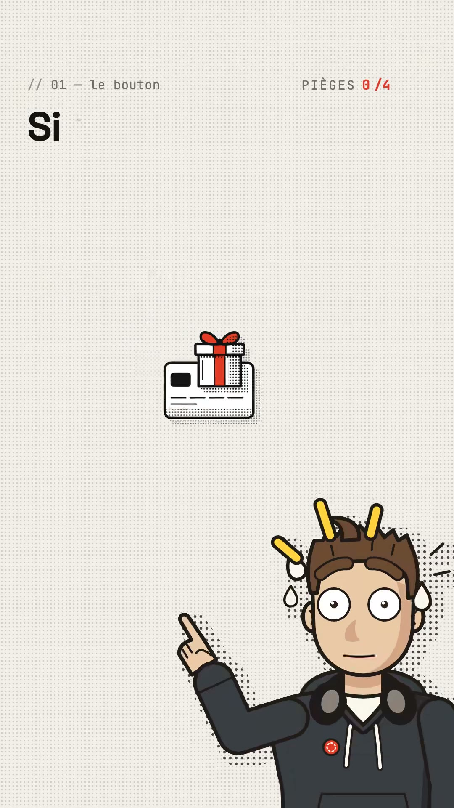

**Personnes :** l'avatar a les yeux écarquillés, la bouche plate, des gouttes de sueur et trois traits jaunes de surprise au-dessus de la tête. Il pointe l'index vers le haut.
**Décor :** même fond crème. Le titre s'écrit (« Si… »). Au centre, une icône de carte bancaire blanche surmontée d'un paquet cadeau à ruban rouge, en trame de points.
**Lumière & caméra :** plan fixe frontal ; l'icône centrale apparaît avec un petit rebond et l'ombre en trame est décalée.

**Prompt Midjourney :**
```
vertical video frame, flat 2D motion design, cream paper background with fine dot grid, top-left monospace label "// 01 — le bouton", top-right counter "PIÈGES 0/4" in red, single bold black grotesk word "Si" top-left, centered icon of a white credit card with a small gift box tied with a red ribbon on top, halftone dot drop shadow, bottom-right cartoon young man with spiky brown hair, wide startled round eyes, sweat drops, three yellow surprise strokes above his head, pointing index finger upward, charcoal hoodie, grey headphones around neck, red pin, thick black outlines, Ben-Day halftone shadow, minimal clean layout --ar 9:16 --style raw --v 7
```
**Prompt Stable Diffusion :**
```
flat 2d motion graphics, vertical 9:16, cream paper background, dot grid, credit card icon with gift box, red ribbon, halftone shadow, cartoon young man, startled wide eyes, sweat drops, yellow surprise lines, pointing finger up, spiky brown hair, charcoal hoodie, headphones around neck, red pin, thick black outline, cel shading, minimalist editorial layout, monospace labels, bold black sans-serif word
```
**Negative :**
```
photorealistic, photo, 3d, dark background, gradient, clutter, blurry text, misspelled text, extra fingers, deformed hands, anime, watermark, logo, low quality
```

#### Scène 3 (00:06–00:11) : Le cadeau, carte « Reset · Claude Opus 5.5 »
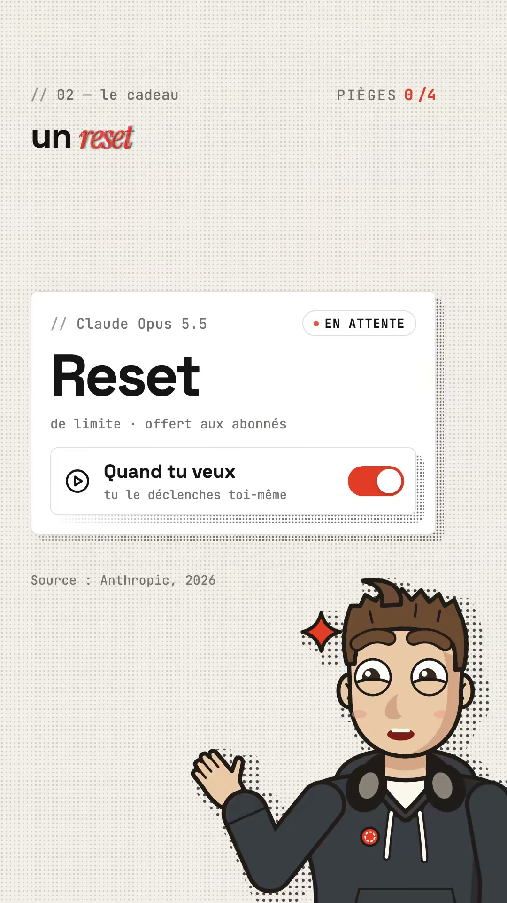

**Personnes :** l'avatar sourit, les joues roses, les yeux mi-clos de contentement. Il lève une main ouverte comme pour présenter quelque chose. Une étincelle rouge à quatre branches flotte près de sa tête.
**Décor :** label « // 02 — le cadeau ». Grande carte blanche aux coins arrondis et à l'ombre en trame : « // Claude Opus 5.5 », pastille « ● EN ATTENTE », « Reset » en très gros noir et « de limite · offert aux abonnés » en mono. Dessous, une sous-carte « ▷ Quand tu veux / tu le déclenches toi-même » avec un interrupteur qui passe du gris au rouge. Sous la carte, la mention « Source : Anthropic, 2026 ». Le mot du titre « reset » est en serif italique rouge avec un dédoublement RVB (glitch).
**Lumière & caméra :** plan fixe ; la carte monte en fondu, l'interrupteur bascule pile sur « à déclencher quand tu veux » et le mot accent tremble avec un glitch.

**Prompt Midjourney :**
```
vertical video frame, flat 2D product UI motion graphics, cream paper background with fine dot grid, top-left monospace label "// 02 — le cadeau", large white rounded UI card with halftone dot drop shadow, inside: small grey monospace "// Claude Opus 5.5", outlined pill badge with red dot "EN ATTENTE", giant bold black word "Reset", monospace line "de limite · offert aux abonnés", nested card with a play icon, bold text "Quand tu veux", monospace subtext "tu le déclenches toi-même", red toggle switch turned on, small grey caption "Source : Anthropic, 2026" below, bottom-right cartoon young man smiling with rosy cheeks, raised open palm presenting, red four-point sparkle near his head, spiky brown hair, charcoal hoodie, headphones around neck, thick black outlines, Ben-Day halftone shadow --ar 9:16 --style raw --v 7
```
**Prompt Stable Diffusion :**
```
flat 2d ui motion graphics, vertical 9:16, cream dot grid background, white rounded card, halftone drop shadow, red status pill, giant black word reset, monospace small text, nested settings card, red toggle switch on, play icon, source caption, cartoon young man, happy smile, rosy cheeks, open palm presenting, red sparkle, spiky brown hair, charcoal hoodie, headphones around neck, thick black outline, clean editorial layout, red black cream palette
```
**Negative :**
```
photorealistic, real screenshot, 3d, glassmorphism, dark mode, neon, gradient, clutter, blurry text, misspelled text, extra fingers, deformed hands, anime, watermark, low quality
```

#### Scène 4 (00:11–00:19) : Le chemin, « Réglages → Utilisation → Resets → Reset for free »
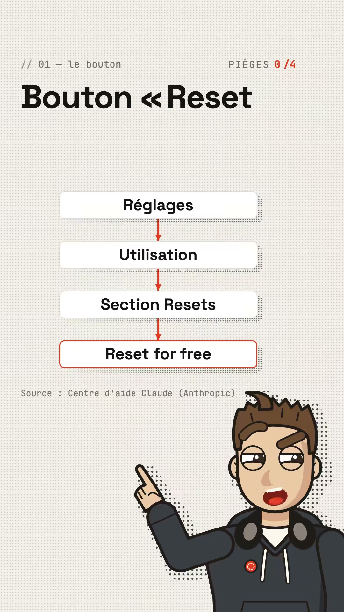
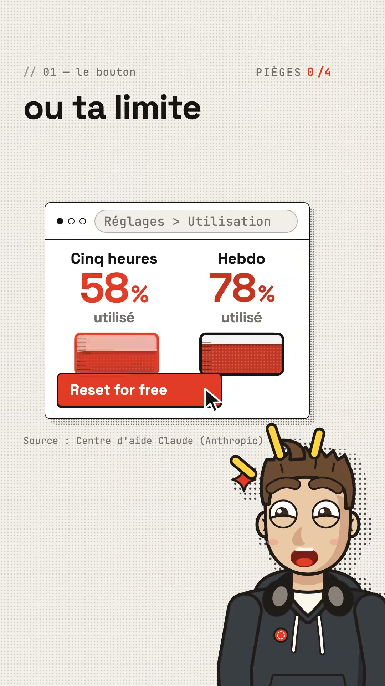

**Personnes :** l'avatar pointe l'index vers le schéma, sourcils froncés, bouche grande ouverte : il insiste. Au moment du clic (00:18), il prend un air surpris et ravi, avec des traits jaunes et les joues roses.
**Décor :** quatre boutons blancs empilés et reliés par des flèches rouges qui se dessinent : « Réglages », « Utilisation », « Section Resets », puis « Reset for free » avec un contour rouge. Le titre dit « Bouton « Reset… ». Ensuite, une fenêtre de navigateur stylisée avec trois points et une barre d'adresse « Réglages > Utilisation » affiche deux jauges, « Cinq heures 58 % utilisé » et « Hebdo 78 % utilisé », en gros chiffres rouges, avec des barres rouges tramées. Un bouton rouge plein « Reset for free » est cliqué par un curseur. Mention « Source : Centre d'aide Claude (Anthropic) ».
**Lumière & caméra :** plan fixe. Les étapes apparaissent une par une, synchronisées sur chaque mot de la voix, et les flèches se tracent de haut en bas. La jauge se vide après le clic (flou de mouvement visible sur la barre de gauche).

**Prompt Midjourney :**
```
vertical video frame, flat 2D tutorial motion graphics, cream paper background with fine dot grid, top-left monospace label "// 01 — le bouton", top-right counter "PIÈGES 0/4", bold black grotesk headline "ou ta limite", stylized white browser window with three dots and address pill "Réglages > Utilisation", two usage meters side by side: "Cinq heures 58% utilisé" and "Hebdo 78% utilisé" in huge red numerals, red halftone progress bars, solid red button "Reset for free" being clicked by a black arrow cursor, halftone drop shadow, grey caption "Source : Centre d'aide Claude (Anthropic)", bottom-right cartoon young man with surprised happy face, rosy cheeks, yellow surprise strokes, spiky brown hair, charcoal hoodie, headphones, thick black outlines --ar 9:16 --style raw --v 7
```
**Prompt Stable Diffusion :**
```
flat 2d tutorial ui animation frame, vertical 9:16, cream dot grid background, white browser window mockup, breadcrumb settings usage, two usage gauges, big red percentage numbers 58 and 78, red halftone progress bars, red reset button, mouse cursor clicking, step flowchart with red arrows, white rounded buttons, cartoon young man pointing, surprised happy face, yellow surprise lines, spiky brown hair, charcoal hoodie, headphones around neck, thick black outline, minimal editorial design
```
**Negative :**
```
photorealistic, real screenshot, 3d, dark mode, neon glow, gradient, cluttered ui, blurry text, misspelled text, extra fingers, deformed hands, anime, watermark, low quality
```

#### Scène 5 (00:19–00:22) : Le retournement en mode sombre, « Sauf qu'il y a quatre »
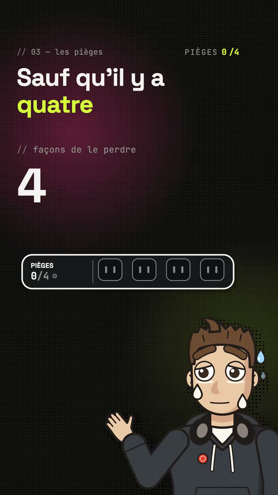

**Personnes :** l'avatar est inquiet, sourcils relevés au centre, une larme sous chaque œil et une goutte de sueur bleue. Il lève la main en signe d'impuissance.
**Décor :** rupture totale. Le fond passe au noir mat (#0E0F0C environ) avec la grille de points, un halo magenta (#7A1E4A environ) en haut à gauche et un halo vert olive en bas à droite. Label « // 03 — les pièges ». Titre blanc « Sauf qu'il y a » et « quatre » en jaune-lime (#D7F23A environ). Sous-label « // façons de le perdre » et un énorme « 4 » blanc. Une barre de progression noire au contour blanc affiche « PIÈGES 0/4 » avec quatre emplacements vides en forme de prise.
**Lumière & caméra :** lueurs colorées diffuses (aplats en dégradé radial), contraste fort. Plan fixe ; c'est le passage du clair au sombre qui fait la coupure, sans transition.

**Prompt Midjourney :**
```
vertical video frame, flat 2D motion graphics in dark mode, matte near-black background with subtle dot grid, soft magenta radial glow top-left and olive green glow bottom-right, top-left grey monospace label "// 03 — les pièges", bold white grotesk headline "Sauf qu'il y a" with the word "quatre" in acid lime yellow, monospace subtitle "// façons de le perdre", giant white numeral "4", black rounded progress bar with white outline reading "PIÈGES 0/4" and four empty socket slots, bottom-right cartoon young man worried with teary eyes and a blue sweat drop, raised helpless hand, spiky brown hair, charcoal hoodie, headphones, thick black outlines, halftone shadow --ar 9:16 --style raw --v 7
```
**Prompt Stable Diffusion :**
```
flat 2d motion graphics, dark mode, vertical 9:16, near-black background, dot grid, magenta radial glow, olive green glow, white bold sans-serif headline, acid lime accent word, giant white number 4, monospace labels, black progress bar with four empty socket slots, cartoon young man worried, teary eyes, blue sweat drop, raised hand, spiky brown hair, charcoal hoodie, headphones around neck, thick black outline, cel shading, high contrast
```
**Negative :**
```
photorealistic, photo, 3d render, light background, cream background, clutter, blurry text, misspelled text, extra fingers, deformed hands, anime, watermark, low quality, oversaturated neon
```

#### Scène 6 (00:22–00:33) : Les 4 pièges, barre de « prises » et cartes
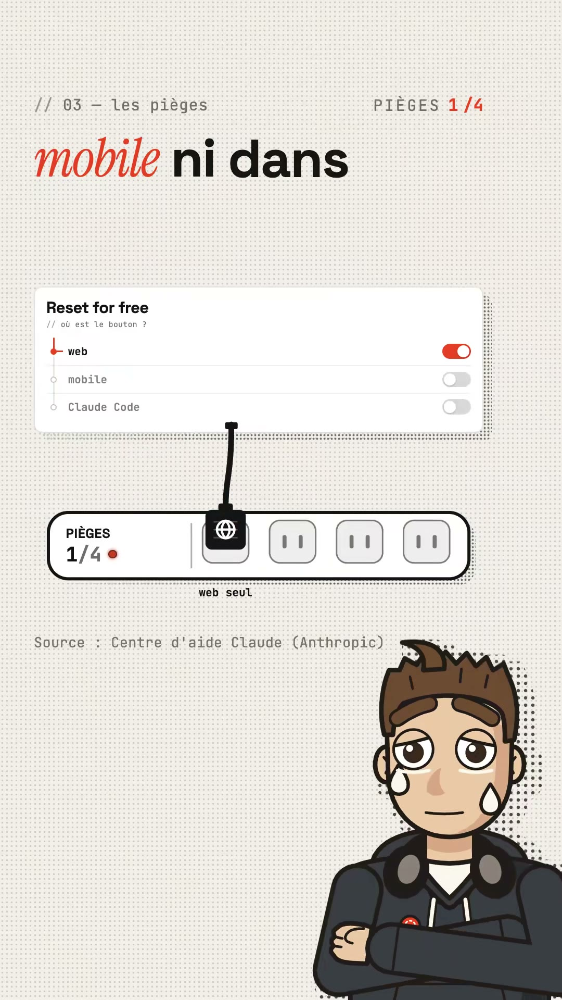
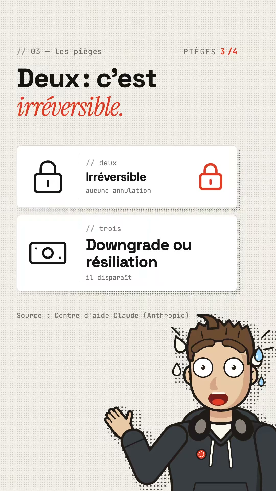
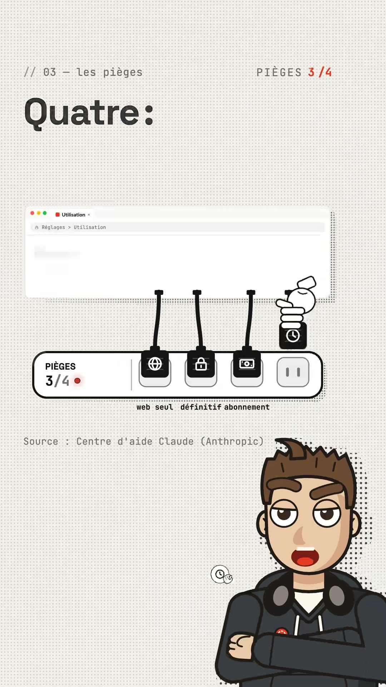

**Personnes :** l'avatar alterne entre les bras croisés avec des larmes (piège 1), la panique avec les yeux exorbités, la sueur et la main levée (pièges 2 et 3), et les bras croisés avec un air sévère qui parle (piège 4).
**Décor :** retour au fond crème, label « // 03 — les pièges ». Piège 1 : une carte « Reset for free / // où est le bouton ? » avec trois interrupteurs (web activé en rouge, mobile et Claude Code désactivés) ; un câble noir descend et branche une prise noire avec une icône globe dans la barre « PIÈGES 1/4 », légende « web seul ». Pièges 2 et 3 : deux cartes horizontales, un cadenas noir à gauche et rouge à droite « // deux Irréversible / aucune annulation », un billet « // trois Downgrade ou résiliation / il disparaît ». Le titre dit « Deux : c'est *irréversible.* » avec l'accent rouge. Piège 4 : une fenêtre « Utilisation » floutée, d'où quatre câbles descendent ; une main de dessin animé enfonce la dernière prise (icône horloge). Légendes : « web seul », « définitif », « abonnement ».
**Lumière & caméra :** plan fixe ; les prises descendent avec une petite gravité puis s'enclenchent, chaque emplacement se remplit en noir et le chiffre du compteur passe en rouge.

**Prompt Midjourney :**
```
vertical video frame, flat 2D explainer motion graphics, cream paper background with fine dot grid, top-left monospace label "// 03 — les pièges", top-right counter "PIÈGES 3/4" in red, bold black grotesk headline "Deux : c'est" with "irréversible." in red italic serif, two white horizontal cards with halftone drop shadows: first with a black padlock icon, monospace "// deux", bold "Irréversible", "aucune annulation", and a red padlock on the right; second with a banknote icon, "// trois", bold "Downgrade ou résiliation", "il disparaît", grey caption "Source : Centre d'aide Claude (Anthropic)", bottom-right cartoon young man panicking with huge round eyes, sweat drops flying, open mouth, raised hand, spiky brown hair, charcoal hoodie, headphones, thick black outlines, Ben-Day halftone shadow --ar 9:16 --style raw --v 7
```
**Prompt Stable Diffusion :**
```
flat 2d explainer motion graphics, vertical 9:16, cream dot grid background, white horizontal info cards, padlock icon, banknote icon, red padlock, monospace labels, bold black sans-serif titles, red italic serif accent word, progress bar with plug sockets, black plug tiles with globe lock money clock icons hanging from cables, cartoon young man panicking, sweat drops, wide eyes, raised hand, spiky brown hair, charcoal hoodie, headphones around neck, thick black outline, halftone shadow, minimal editorial layout
```
**Negative :**
```
photorealistic, photo, 3d, dark background, neon, gradient mesh, clutter, blurry text, misspelled text, extra fingers, deformed hands, anime, watermark, low quality
```

#### Scène 7 (00:33–00:39) : Verdict et CTA, « Enregistre » + question en commentaires
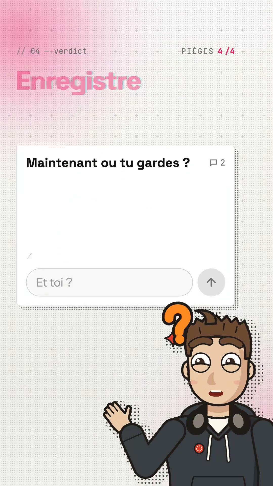
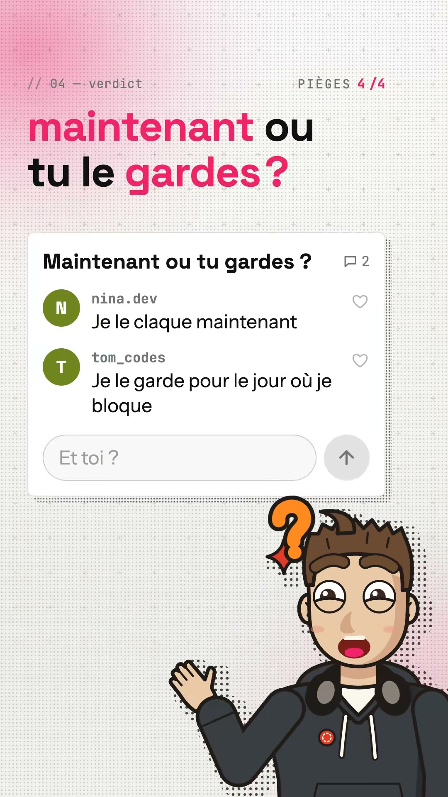

**Personnes :** à 00:33, l'avatar a les paupières mi-closes, un sourire satisfait et pointe le haut. Ensuite, un gros point d'interrogation orange apparaît à côté de sa tête ; il a les joues roses, la bouche ouverte et la main levée comme pour inviter à répondre.
**Décor :** label « // 04 — verdict », compteur « PIÈGES 4/4 » en rose. Le fond crème est envahi en haut à gauche par un lavis rose fuchsia, avec une grille de petites croix « + ». Le mot « Enregistre » est en rose avec une aberration chromatique (glitch), puis le titre devient « *maintenant* ou tu le *gardes* ? » avec les mots-clés en rose fuchsia (#F0307A environ). Une carte de fil de commentaires « Maintenant ou tu gardes ? 💬 2 » contient les faux commentaires « nina.dev : Je le claque maintenant » et « tom_codes : Je le garde pour le jour où je bloque », avec des avatars ronds vert olive à initiale, des cœurs, un champ « Et toi ? » et un bouton d'envoi rond.
**Lumière & caméra :** plan fixe. Le lavis rose arrive en fondu, les commentaires tombent un par un et le mot « Enregistre » tremble en séparation RVB. Un plan quasi vide d'environ une seconde ouvre la section (respiration, risque de swipe).

**Prompt Midjourney :**
```
vertical video frame, flat 2D social motion graphics, cream paper background with fine grid of tiny plus signs, soft hot-pink watercolor wash bleeding from the top-left corner, top-left monospace label "// 04 — verdict", top-right counter "PIÈGES 4/4" in pink, bold grotesk headline "maintenant ou tu le gardes ?" with "maintenant" and "gardes" in hot pink, white comment thread card with halftone drop shadow: title "Maintenant ou tu gardes ?" with speech bubble icon "2", two comments with olive green round initial avatars "nina.dev — Je le claque maintenant" and "tom_codes — Je le garde pour le jour où je bloque", outline heart icons, rounded input field "Et toi ?" and round grey send arrow button, bottom-right cartoon young man with big orange question mark next to his head, rosy cheeks, open mouth, raised palm inviting, spiky brown hair, charcoal hoodie, headphones, thick black outlines --ar 9:16 --style raw --v 7
```
**Prompt Stable Diffusion :**
```
flat 2d social media motion graphics, vertical 9:16, cream background with plus sign grid, hot pink watercolor wash top left corner, bold black and hot pink sans-serif headline, chromatic aberration glitch text, white comment thread card, round olive green initial avatars, heart icons, rounded input field, send arrow button, cartoon young man, orange question mark, rosy cheeks, open mouth, raised palm, spiky brown hair, charcoal hoodie, headphones around neck, thick black outline, halftone shadow, clean editorial layout
```
**Negative :**
```
photorealistic, real screenshot, 3d, dark background, neon, clutter, blurry text, misspelled text, extra fingers, deformed hands, anime, watermark, real usernames, low quality
```

#### Style global

Une **DA « fiche technique éditoriale »** en motion design 2D sans tournage :
- **Palette :** fond papier crème avec grille de points (#F1EEE8), encre noire (#111), un seul accent rouge brique (#E0402A) pour les mots-clés, les interrupteurs et les chiffres. Deux ruptures volontaires : le mode sombre avec halos magenta et vert et un accent jaune-lime (#D7F23A) pour le retournement, puis un lavis rose fuchsia (#F0307A) pour le CTA.
- **Typographie :** trois familles. Une grotesk géométrique noire très grasse pour les titres (type Space Grotesk). Une serif italique condensée rouge pour le seul mot émotionnel de chaque phrase (type Instrument Serif Italic). Une monospace grise pour les labels préfixés `//`, comme des commentaires de code (type JetBrains Mono), qui fait un clin d'œil à l'audience dev.
- **Habillage :** cartes UI blanches aux coins arrondis avec une ombre portée en trame de points décalée (effet print, risographie), stickers-pilules inclinés, icônes au trait épais, compteur de progression persistant en haut à droite.
- **Personnage :** un avatar de présentateur illustré, fixe en bas à droite, avec une dizaine d'expressions réutilisables. Il remplace la face-cam et permet de produire en série.
- **Animation :** titres écrits mot par mot synchronisés sur la voix, flou d'entrée, glitch RVB sur les mots-accents, rebonds sur les éléments graphiques, aucun mouvement de caméra.
- **Texte :** Midjourney v7 et Stable Diffusion rendent mal le texte long. Il vaut mieux générer les fonds, les cartes vides et l'avatar, puis poser le texte au montage (HTML/GSAP, After Effects, CapCut).

**Prompt maître :**
```
vertical 9:16 social video frame in a flat 2D editorial tech explainer style, off-white cream paper background with a fine grey dot grid, small grey monospace labels prefixed with "//" like code comments, top-right progress counter in red, huge heavy black geometric grotesk headline with a single emotional keyword in red condensed italic serif, white rounded UI cards with thin borders and offset black Ben-Day halftone drop shadows, tilted pill stickers, bold-outline line icons, single brick-red accent color, bottom-right recurring cartoon presenter: young man with spiky brown hair and a cowlick, thick black outlines, flat cel shading, dark charcoal hoodie with white drawstrings, grey headphones around his neck, small red round pin, expressive face, halftone shadow behind him, lots of negative space, Swiss grid, print-risograph texture, clean and minimal --ar 9:16 --style raw --v 7
```

### Annexe : transcription horodatée

Moteur : Whisper `base` (local), langue fr (100 %). Texte brut, sans correction.

[00:00.0] Claude t'a offert un bouton caché, il va expirer.
[00:02.8] Si tu payes Claude, regarde ça avant de le perdre.
[00:05.7] Avec Claude plus 5.5, entrepique a offert aux abonnés un reset de limite,
[00:09.6] à déclencher quand tu veux.
[00:10.9] Il est là, réglage, utilisation, section reset, bouton reset for free.
[00:15.7] Un clic, t'as limite de 5 heures ou t'as limite hebdo, repare à zéro.
[00:19.5] Sauf qu'il y a quatre façons de le perdre.
[00:22.1] Un, pas de bouton sur mobile ni dans Claude code, passe par le web.
[00:25.6] Deux, c'est irréversible.
[00:27.2] Trois, tu dain de grade ou tu résilies, il disparaît.
[00:29.8] Quatre, il expir.
[00:31.4] La date est dans tes réglages.
[00:33.0] C'est un joker, garde-le pour le jour où tu bloques.
[00:35.8] Enregistre ça, et toi, tu le claques maintenant ou tu le garde ?
