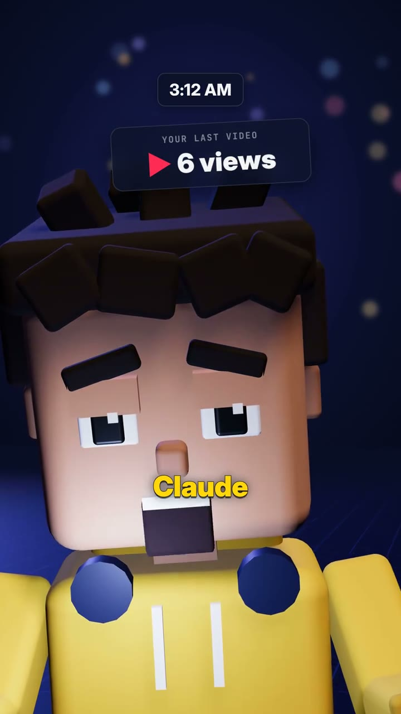
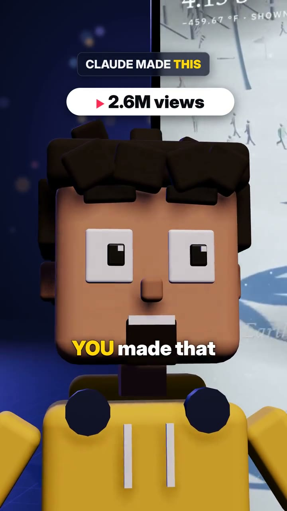
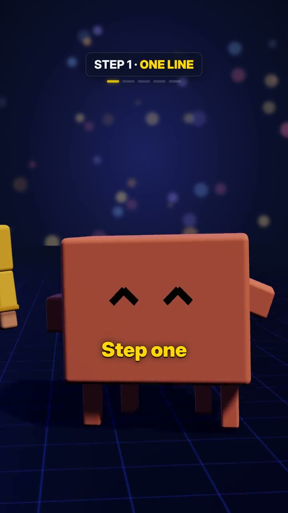
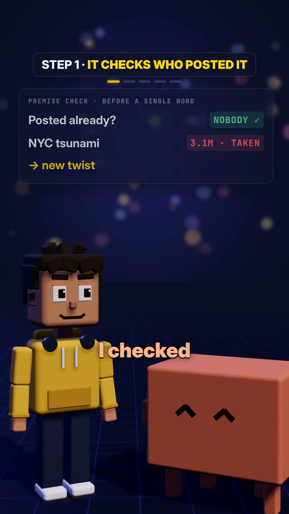
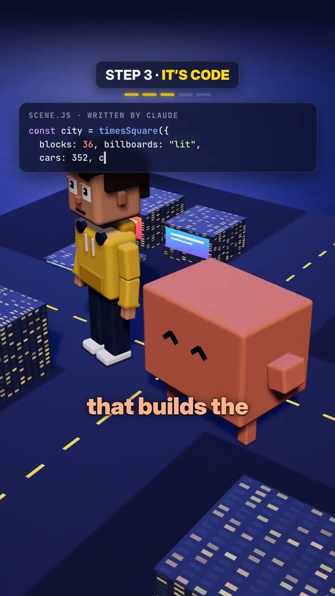
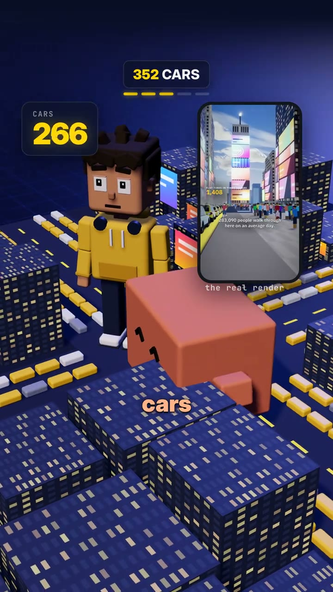
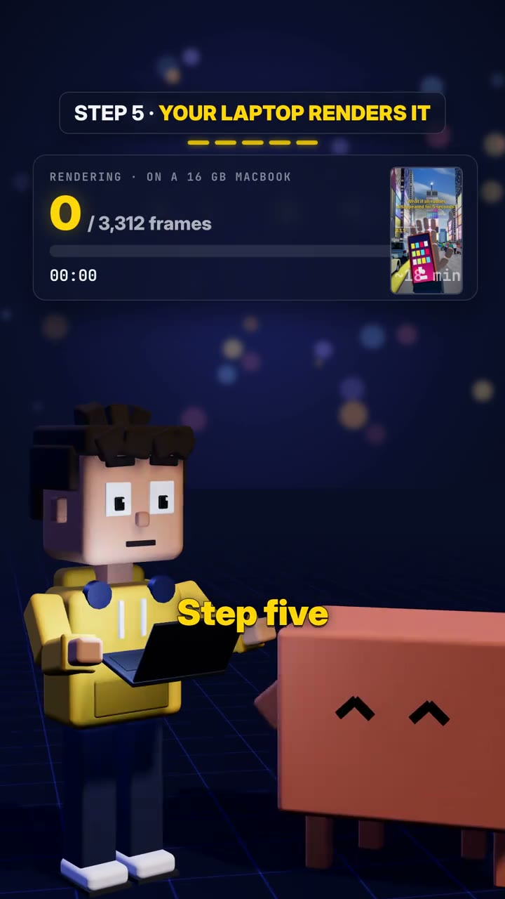
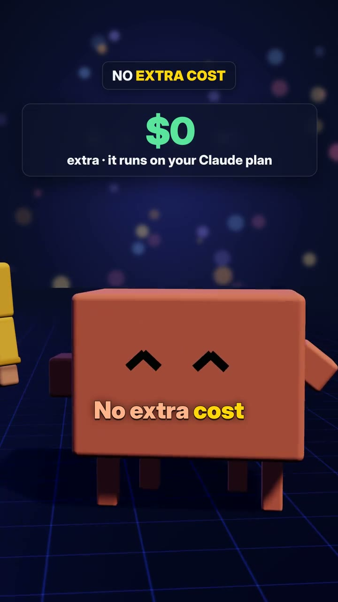
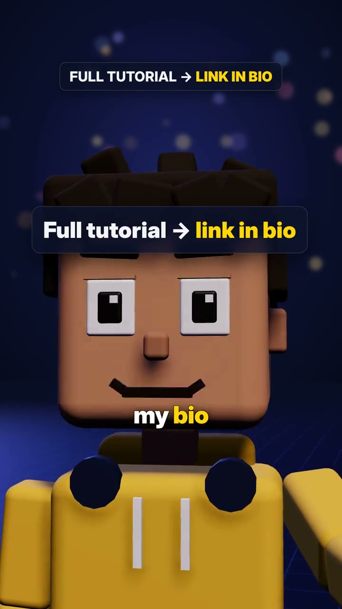

# 1. Informations de la vidéo

- **Titre :** How to make viral 3D videos with Claude Code 😳 Full tutorial in my bio. What should Claude build next? 👇
- **Auteur / chaîne :** What If Sim (@whatif.sim)
- **Plateforme :** TikTok
- **URL :** https://www.tiktok.com/@whatif.sim/video/7701790220236131597
- **Date de publication :** 28/10/2026
- **Durée :** 63 s
- **Vues / likes / commentaires :** 826 600 vues · 71 000 likes · 451 commentaires (au 02/11/2026)
- **Langue :** anglais
- **Résolution :** 1080×1920 annoncée (fichier téléchargé : 720×1280, 30 i/s)
- **Hashtags :** #claudecode #claude #aivideo #3danimation #facelessvideo

# 2. Transcription textuelle complète (générée par Riverside)

**[00:00]** Uh, Claude, my last video got 6 views.  Six? This one got 2.6 million!  Wait, you made that? That one and 55 more. Almost 35 million views. Okay, nobody ever shows how! Show me! Step 1. Give me one line. Um, what if all rubber disappeared for 5 seconds?  Nobody's posted that yet. I checked. Step 2. I find a source for every fact. And then you generate the video?

**[00:29]** Nope, not AI video. I write code that builds the whole world. Times square,  352 cars. But I can't code!  You never touch it. Step four, I check my own frames and fix what's weak. Step five, your laptop renders it. 3000 frames, 18 minutes.  Okay, how much does that cost? No extra cost. It runs on your Claude plan. That's it? That's it. Seven prompts.

**[00:59]** tutorials in my bio!

# 3. Résumé des idées clés de la transcription

Un dialogue entre un créateur débutant (garçon en voxels, sweat jaune) et « Claude » (un bloc orange à pattes). Le créateur se plaint : sa dernière vidéo a fait 6 vues. Claude répond que la sienne en a fait 2,6 millions, et 56 vidéos près de 35 millions au total. Claude dévoile alors sa méthode en 5 étapes : une idée en une phrase (« et si… »), une vérification que personne ne l'a déjà publiée, une source pour chaque fait, du code qui construit tout le monde en 3D (pas de vidéo générée par IA), une relecture de ses propres images, puis un rendu sur l'ordinateur. Chute : pas de coût en plus de l'abonnement Claude, « sept prompts », tutoriel dans la bio.

**Idées clés**
- Le hook joue sur le contraste de chiffres : 6 vues contre 2,6 millions.
- La preuve sociale arrive tout de suite : un mur de 56 miniatures, « ~35M views ».
- La méthode tient en étapes numérotées, avec une barre de progression à l'écran (STEP 1 à 5).
- La rareté : « Nobody's posted that yet. I checked » (personne ne l'a encore fait), avec une carte qui marque les idées « TAKEN » (déjà prises).
- Ils lèvent l'objection technique : « But I can't code! » → « You never touch it. »
- Ils lèvent l'objection du prix : « No extra cost. It runs on your Claude plan. »
- La simplicité finale : « That's it. Seven prompts. »

**Citations marquantes**
- [00:00] « Claude, my last video got 6 views. » / « This one got 2.6 million! »
- [00:13] « Nobody's posted that yet. I checked. »
- [00:29] « Nope, not AI video. I write code that builds the whole world. »
- [00:41] « 3000 frames, 18 minutes. »
- [00:52] « No extra cost. It runs on your Claude plan. »

**Appel à l'action :** « Full tutorial → link in bio » (tutoriel dans la bio), et dans la légende : « What should Claude build next? 👇 » (question pour les commentaires).

# 4. Éléments visuels et prompts

## Scène 1 (00:00–00:12) : le hook « 6 vues contre 2,6 millions »



**Personnes :** un garçon en voxels (style jouet en blocs) : tête cubique, peau mate, cheveux bruns en blocs ébouriffés, gros yeux carrés blancs à pupilles noires, sourcils épais en blocs, sweat jaune moutarde à cordons blancs, boutons ronds bleu nuit aux épaules. Expression dépitée, puis bouche ouverte de surprise. En face, « Claude » : un pavé orange terre cuite, arrondi, avec deux yeux en accent circonflexe « ^ ^ » et quatre petites pattes. Il tient une tablette.
**Décor :** studio infini bleu nuit, sol en grille bleue lumineuse, bokeh de points jaunes, roses et bleus en fond. Interface flottante : heure « 3:12 AM », badge « YOUR LAST VIDEO ▶ 6 views », tablette « CLAUDE MADE THIS » qui montre une plage ensoleillée (« What if Earth hit absolute zero for 5 seconds? »), pilule blanche « ▶ 2.6M views », mur de 56 miniatures « ~35M views ».
**Lumière et caméra :** lumière de studio douce venant d'en haut et de face, contre-jour bleu froid, ombres douces. Gros plans serrés sur le visage à hauteur des yeux, petits travellings et poussées de caméra, faible profondeur de champ (fond en bokeh). Sous-titres mot à mot en blanc gras, avec le mot fort en jaune.

**Prompt Midjourney :**
```
3D render of a cute blocky voxel boy character with a cubic head, warm tan skin, messy chunky dark brown hair, big square white eyes with black pupils, thick block eyebrows, mustard yellow hoodie with white drawstrings, looking disappointed at a floating UI badge "6 views", next to a rounded terracotta orange box creature with tiny legs and happy caret eyes holding a tablet, dark navy infinite studio, glowing blue grid floor, colorful bokeh particles, soft top key light, cool blue rim light, shallow depth of field, Blender Cycles, toy-like clay materials, cinematic close-up, vertical composition --ar 9:16 --style raw --v 7
```
**Prompt Stable Diffusion :**
```
3d render, blocky voxel boy, cubic head, tan skin, chunky brown hair, square cartoon eyes, mustard yellow hoodie, terracotta orange box character with caret eyes and small legs, holding tablet, floating ui cards, dark navy studio, glowing blue grid floor, bokeh lights, soft key light, blue rim light, shallow depth of field, blender cycles, clay toy materials, cinematic, vertical 9:16, high detail
```
**Negative :**
```
photorealistic human, realistic skin, text artifacts, watermark, logo, extra limbs, deformed face, low poly glitches, harsh shadows, overexposed, blurry subject, noisy, cluttered background
```

## Scène 2 (00:13–00:28) : étapes 1 et 2, l'idée et la vérification



**Personnes :** le bloc orange « Claude », de face, yeux « ^ ^ » joyeux. Le garçon tape au clavier puis réfléchit, la tête légèrement penchée. Il est petit en arrière-plan quand Claude parle.
**Décor :** même studio bleu nuit. En haut, le titre « STEP 1 · ONE LINE » avec cinq tirets de progression (les actifs en jaune). Un terminal sombre « > What if all rubber di▌ », puis une carte « PREMISE CHECK · BEFORE A SINGLE WORD » : « Posted already? » → « NOBODY ✓ » en vert, « NYC tsunami · 3.1M · TAKEN » en rouge, « → new twist ».
**Lumière et caméra :** plan moyen à hauteur de poitrine, légère contre-plongée sur Claude, cartes d'interface en verre fumé, lueur jaune sur les titres.

**Prompt Midjourney :**
```
3D render of a rounded terracotta orange box character with tiny legs and happy caret-shaped eyes standing on a glowing blue grid floor, a small blocky voxel boy in a yellow hoodie typing on a floating dark terminal window in the background, dark glassmorphism UI card with a checklist "NOBODY" in green and "TAKEN" in red, navy studio with soft bokeh, top step progress bar with yellow dashes, soft studio lighting, blue rim light, clean motion graphics look, Blender render --ar 9:16 --style raw --v 7
```
**Prompt Stable Diffusion :**
```
3d render, cute terracotta orange box mascot, caret eyes, tiny legs, glowing blue grid floor, voxel boy in yellow hoodie typing, floating dark terminal, glassmorphism ui card, checklist green and red tags, yellow step progress bar, navy background, bokeh, soft studio lighting, rim light, motion graphics, blender, vertical 9:16
```
**Negative :**
```
realistic human, photo, messy text, misspelled words, watermark, extra eyes, deformed shapes, harsh lighting, low resolution, grainy, cluttered
```

## Scène 3 (00:29–00:40) : étape 3, du code qui construit le monde



**Personnes :** le garçon et Claude, minuscules, posés sur une ville miniature. Le garçon tient un téléphone.
**Décor :** une carte de code « SCENE.JS · WRITTEN BY CLAUDE » (`const city = timesSquare({ blocks: 36, billboards: "lit", cars: 352 })`). Ville en voxels vue de haut : immeubles bleu nuit aux fenêtres jaunes, avenues avec des files de petites voitures colorées, panneaux lumineux. Compteur « 352 CARS / 266 » qui monte, téléphone qui montre le vrai rendu de Times Square. Titre « YOU NEVER TOUCH THE CODE ».
**Lumière et caméra :** plongée en diagonale façon maquette (effet miniature), nuit bleue, fenêtres éclairées en jaune chaud, travelling latéral au-dessus de la ville.

**Prompt Midjourney :**
```
isometric 3D voxel miniature city at night, dark navy blocky skyscrapers with warm yellow lit windows, glowing billboards, streets full of tiny colorful block cars, a tiny voxel boy in a yellow hoodie and a terracotta orange box creature standing on a rooftop holding a phone showing the real render, floating dark code card with javascript, high-angle diagonal camera, tilt-shift miniature look, soft blue night lighting, Blender render, playful toy aesthetic --ar 9:16 --style raw --v 7
```
**Prompt Stable Diffusion :**
```
isometric voxel city, night, navy skyscrapers, yellow lit windows, neon billboards, tiny colorful cars, voxel boy yellow hoodie, orange box mascot, rooftop, phone screen, floating code card, high angle, tilt shift, miniature, blue night light, blender render, toy style, vertical 9:16
```
**Negative :**
```
photorealistic city, real people, daylight, fog, blurry, distorted perspective, watermark, logo, text errors, low detail, noise
```

## Scène 4 (00:41–00:56) : étapes 4 et 5, le rendu et le prix



**Personnes :** le garçon, son ordinateur portable ouvert dans les bras, regarde l'écran, surpris. Claude grand au premier plan, yeux « ^ ^ », satisfait.
**Décor :** carte « RENDERING · ON A 16 GB MACBOOK » avec un compteur « 0 → 3,229 / 3,312 frames », une barre jaune qui se remplit et un chrono « 00:00 → 17:32 ». Puis la carte « $0 · extra · it runs on your Claude plan » en vert, et enfin le titre « 7 PROMPTS ».
**Lumière et caméra :** plan moyen, caméra fixe avec une légère poussée, compteurs animés, même bokeh.

**Prompt Midjourney :**
```
3D render of a blocky voxel boy in a mustard yellow hoodie holding an open laptop and staring at it in surprise, a big terracotta orange box creature with happy caret eyes in the foreground, floating dark UI card showing a rendering progress bar filling in yellow with a frame counter, dark navy studio, glowing blue grid floor, colorful bokeh, soft key light, blue rim light, shallow depth of field, Blender Cycles --ar 9:16 --style raw --v 7
```
**Prompt Stable Diffusion :**
```
3d render, voxel boy yellow hoodie, holding open laptop, surprised, orange box mascot with caret eyes, floating ui progress bar, yellow fill, frame counter, navy studio, blue grid floor, bokeh, soft key light, rim light, shallow depth of field, blender cycles, vertical 9:16
```
**Negative :**
```
realistic human, photo, wrong numbers, garbled text, watermark, extra fingers, deformed laptop, harsh shadows, overexposed, low resolution
```

## Scène 5 (00:57–01:03) : appel à l'action


**Personnes :** très gros plan sur le visage du garçon, sourire franc, regard caméra.
**Décor :** carte « Full tutorial → link in bio » (« link in bio » en jaune), titre « FULL TUTORIAL → LINK IN BIO » en haut.
**Lumière et caméra :** gros plan frontal, poussée de caméra vers le visage, fond bleu flou.

**Prompt Midjourney :**
```
extreme close-up 3D render of a smiling blocky voxel boy with a cubic head, tan skin, chunky dark brown hair, big square eyes looking at the camera, mustard yellow hoodie, floating dark rounded UI card with bold white text and yellow highlight, deep navy background with soft bokeh, soft frontal key light, cool rim light, shallow depth of field, Blender render --ar 9:16 --style raw --v 7
```
**Prompt Stable Diffusion :**
```
3d render, extreme close-up, smiling voxel boy, cubic head, tan skin, brown block hair, square eyes, looking at camera, yellow hoodie, floating ui card, navy background, bokeh, soft frontal light, rim light, shallow depth of field, blender, vertical 9:16
```
**Negative :**
```
realistic face, photo, creepy, distorted eyes, garbled text, watermark, low resolution, noise, harsh light
```

## Style global de la vidéo

- **Esthétique :** 3D en voxels façon jouet (rendu Blender propre), deux personnages récurrents : le créateur en sweat jaune et « Claude », un bloc orange à pattes. Décor unique de studio bleu nuit, sol en grille lumineuse et bokeh coloré, qui renvoie à l'univers « tech ».
- **Habillage :** cartes d'interface en verre sombre, titres en capitales avec le mot fort en jaune, barre d'étapes à cinq tirets, compteurs animés (vues, voitures, images de rendu, $0), sous-titres mot à mot blancs avec le mot clé en jaune.
- **Narration :** un dialogue en champ-contrechamp, une méthode en étapes numérotées, et chaque objection (« je ne sais pas coder », « combien ça coûte ») tranchée en une phrase. Le format « et si… » est aussi la ligne éditoriale de la chaîne (« What If Sim »).
- **Ce qu'on peut reprendre pour la DA papier :** le duo présentateur + mascotte qui se répondent, la barre d'étapes, la carte « déjà fait / personne ne l'a fait » (la rareté), les compteurs qui montent comme preuve.

**Prompt maître :**
```
playful 3D voxel toy animation still, a blocky boy in a mustard yellow hoodie and a terracotta orange box mascot with caret eyes and tiny legs, dark navy infinite studio with a glowing blue grid floor and colorful bokeh, floating dark glassmorphism UI cards with bold white and yellow text, animated counters, step progress bar, soft studio key light with cool blue rim light, shallow depth of field, clean Blender Cycles render, vertical social video composition --ar 9:16 --style raw --v 7
```
