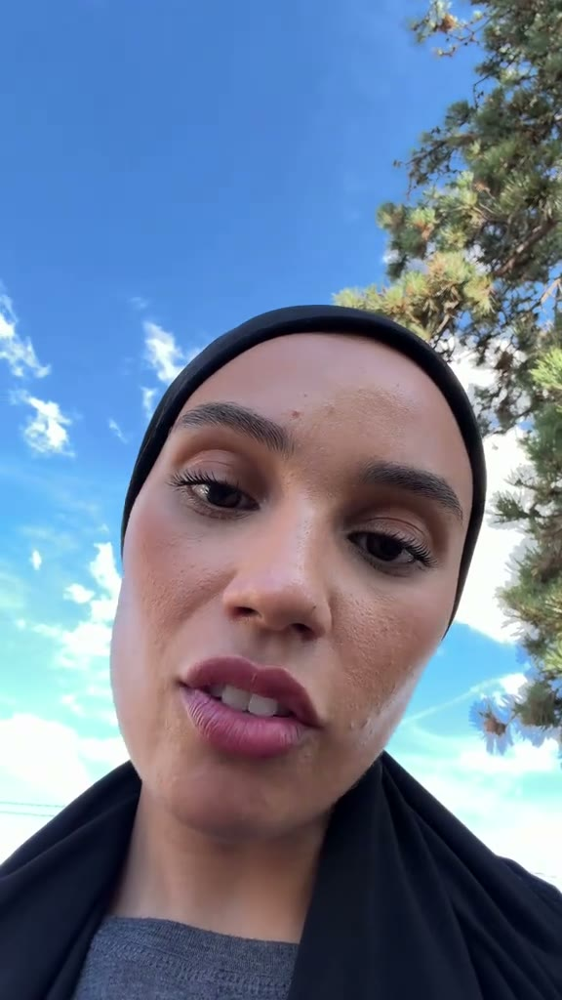
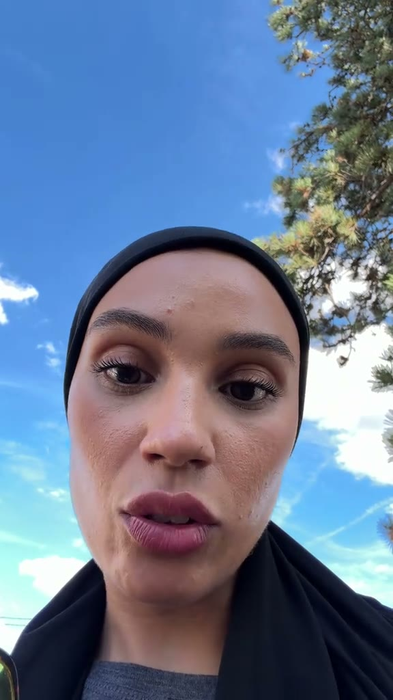

# 1. Informations de la vidéo

- **Titre :** inconnu. Fichier local téléchargé avec ssstik.io (`ssstik.io_1793692582254.mp4`) ; la légende d'origine n'est pas dans le fichier.
- **Auteur / chaîne :** inconnu (pas de lien fourni)
- **Plateforme :** TikTok (téléchargement ssstik.io, métadonnées TikTok dans le fichier)
- **URL :** non fournie
- **Date de publication, vues, likes :** non disponibles
- **Durée :** 61 s
- **Langue :** français
- **Résolution :** 576×1024 (vertical 9:16), 30 i/s

# 2. Transcription textuelle complète (générée par Riverside)

**[00:00]** Je sais que t'as pas envie d'entendre ça mais je vais quand même te le dire d'accord parce que tu en as besoin.  Ce que tu vis est difficile parce que ce qui t'attend est grand.  Je répète, ce que tu vis est difficile parce que ce qui t'attend est grand.  D'accord ? L'épreuve que t'es en train de vivre là, où elle est insupportable, ton coeur il est en train de se déchirer, tu souffres, t'as peur, tu pleures, tu passes des nuits blanches à réfléchir, tu stresses constamment.  Tu sais là, ça te prépare à un avenir qui est incroyable.

**[00:29]** Je sais que tu vas te dire mais c'est des phrases bateaux qu'elle me dit mais je t'assure que c'est la vérité. Ok ? Là ça te prépare juste à un bel avenir, à un avenir incroyable.  Juste toi il faut que tu passes ça, que tu places ta confiance en Dieu, qui lui contrôle tout. Toi tu ne contrôles rien. D'accord ? Mais fais lui confiance.  Fais lui confiance, il a les meilleurs plans pour toi. Donc là t'es en train de souffrir mais je te promets que ce qui t'attend va être incroyable. Donc juste...

**[00:59]** Passons, ok ? Bisous, je t'aime.

# 3. Résumé des idées clés de la transcription

Une femme parle face caméra, au téléphone, à une seule personne qui traverse une épreuve. Son message : la difficulté actuelle prépare un avenir « grand », « incroyable ». Elle décrit la souffrance de la personne avec précision (peur, larmes, nuits blanches, stress) pour qu'elle se sente comprise. Elle anticipe l'objection « ce sont des phrases bateaux » et la désamorce. Puis elle conclut sur la foi : faire confiance à Dieu, qui contrôle tout et a « les meilleurs plans ». Fin intime : « Bisous, je t'aime. »

**Idées clés**
- **Hook en permission inversée :** « Je sais que t'as pas envie d'entendre ça… mais tu en as besoin. » On reste pour savoir ce qu'on « doit » entendre.
- **Une phrase centrale répétée deux fois**, comme un refrain qu'on retient et qu'on partage : « Ce que tu vis est difficile parce que ce qui t'attend est grand. »
- **Le miroir émotionnel :** une liste de symptômes concrets, assez larges pour que beaucoup s'y reconnaissent.
- **L'objection anticipée :** « tu vas te dire… phrases bateaux… mais je t'assure que c'est la vérité ».
- **Le message spirituel :** lâcher le contrôle et faire confiance à Dieu.
- **Le ton :** tutoiement, « d'accord ? » répété (l'impression d'un vrai dialogue), clôture affective (« je t'aime »).

**Citations marquantes**
- [00:00] « Je sais que t'as pas envie d'entendre ça mais je vais quand même te le dire. »
- [00:05] « Ce que tu vis est difficile parce que ce qui t'attend est grand. »
- [00:29] « Je sais que tu vas te dire mais c'est des phrases bateaux… »
- [00:45] « Fais-lui confiance, il a les meilleurs plans pour toi. »
- [00:59] « Bisous, je t'aime. »

**Appel à l'action :** aucun appel explicite (ni abonnement, ni lien). La vidéo mise sur l'envoi à un proche qui va mal et sur l'enregistrement.

**À retenir pour tes vidéos :** le hook « tu n'as pas envie d'entendre ça » et la phrase refrain répétée marchent dans n'importe quel sujet (business, discipline). Mais attention aux promesses absolues (« je te promets que… ») : ta règle est de ne pas en faire.

# 4. Éléments visuels et prompts

## Scène unique (00:00–01:01) : selfie en contre-plongée sous le ciel



**Personnes :** une femme d'environ 30 ans, peau claire à mate, visage fin, sourcils dessinés, rouge à lèvres mauve-rosé mat, léger maquillage des yeux. Elle porte un bonnet ou turban noir moulant qui couvre les cheveux, un vêtement noir ample par-dessus un t-shirt gris chiné. Expression douce et sérieuse, regard droit dans l'objectif, légers mouvements de tête. Vers 00:41, une main entre dans le cadre en tenant des lunettes de soleil.
**Décor :** en extérieur, un ciel bleu vif avec des nuages blancs, des branches de pin à droite du cadre, un fil électrique au loin. Rien d'autre : le décor naturel donne une impression de calme et d'ouverture.
**Lumière et caméra :** lumière du jour diffuse et douce, sans ombre dure sur le visage, une température neutre à légèrement froide. Téléphone tenu à bout de bras, en contre-plongée (le ciel derrière la tête). Grand angle de smartphone (environ 26 mm), tout est net, de petits tremblements à main levée, un seul plan sans coupe. Couleurs naturelles saturées par le téléphone, sans étalonnage ni sous-titres.

**Prompt Midjourney :**
```
candid smartphone selfie video still, low angle looking up, a woman in her early 30s with a fitted black head wrap covering her hair, mauve matte lipstick, subtle eye makeup, black loose outer layer over a heather grey t-shirt, speaking softly and sincerely straight into the camera, vivid blue sky with white clouds behind her head, pine tree branches on the right edge, soft diffuse daylight, natural colors, wide-angle phone lens, slight handheld shake, authentic UGC TikTok look, vertical framing --ar 9:16 --style raw --v 7
```
**Prompt Stable Diffusion :**
```
smartphone selfie, low angle, woman early 30s, black fitted head wrap, mauve matte lipstick, black loose top, grey t-shirt, sincere expression, talking to camera, blue sky, white clouds, pine branches, soft daylight, natural colors, wide angle lens, handheld, ugc, tiktok style, vertical 9:16, photorealistic
```
**Negative :**
```
studio lighting, heavy makeup, harsh shadows, blurry face, distorted features, extra fingers, text, watermark, logo, oversaturated, cartoon, low resolution
```

## Style global de la vidéo

- Format « parole brute » : un seul plan selfie sans montage, sans musique audible, sans sous-titres ni effets. Toute la force vient du texte et du regard caméra.
- La contre-plongée sur le ciel bleu agrandit la personne et ouvre l'image vers le haut, ce qui colle au message d'espoir et de foi.
- Ce format coûte zéro production : il prouve qu'un texte fort et une phrase refrain suffisent pour toucher.

**Prompt maître :**
```
authentic vertical smartphone selfie still, low angle, a person speaking gently and sincerely to the camera against a bright blue sky with soft white clouds and pine branches at the edge, soft natural daylight, wide-angle phone lens, single continuous handheld shot, no text, raw intimate UGC aesthetic --ar 9:16 --style raw --v 7
```
